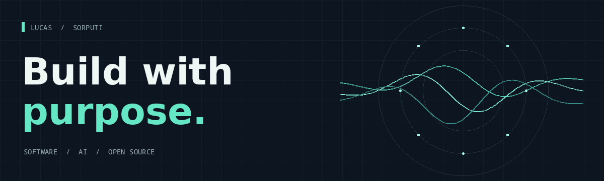

  

# Hi, I'm Lucas.

I'm a software engineer building backend systems, AI-powered tools and developer experiences. I enjoy taking an idea from an experiment to something people can understand, use and build on.

My work spans enterprise software and open source: from APIs and automation to voice technology, browser agents and collaborative developer tools. I believe good engineering is as much about clarity and reliability as it is about code.

[LinkedIn](https://www.linkedin.com/in/lucas-gomes-b14a83309/) · [GitHub](https://github.com/SorPuti) · [Email](mailto:lucas@imovelpericiado.com)

## Selected work

### [TalkWeave](https://github.com/SorPuti/talkweave) · Learning to build full-duplex voice systems

An open-source tutorial and hands-on lab exploring the foundations of a full-duplex voice engine. It brings together Python code, interactive learning material and a Rust portability starter. The included demonstration uses synthetic audio; it's an engineering learning project, not a pretrained conversational voice.

[Explore the tutorial ↗](https://sorputi.github.io/talkweave/)

### [OpenIDEA Collab](https://github.com/SorPuti/openidea-collab) · Collaboration for a native IDE

An experimental collaboration plugin and relay for [OpenIDEA](https://github.com/l0ng-ai/openidea), the open-source IDE built in Rust. The work explores shared documents, authenticated connections and realtime synchronization. Its proposed upstream capabilities are under review, and the plugin is not yet an approved marketplace release.

[Plugin registry proposal ↗](https://github.com/l0ng-ai/openidea-plugins/pull/102) · [OpenIDEA contributions ↗](https://github.com/l0ng-ai/openidea/pulls?q=is%3Apr+author%3ASorPuti)

### [Persistent PageMap](https://github.com/SorPuti/persistent-pagemap) · A structural memory for browser agents

A local SDK for observing and querying web interfaces. It separates what an agent knows from the current state of the page, with validation before actions and adapters for browser and storage integrations.

### [Stride](https://github.com/SorPuti/core-framework) · A Python framework for APIs

An open-source framework exploring a productive approach to building async REST APIs with FastAPI, SQLAlchemy and Pydantic.

## What I work with

- **Backend & architecture:** Python, Java, FastAPI, REST APIs, PostgreSQL, Redis
- **AI & automation:** agent tooling, datasets, browser interaction, voice systems
- **Developer tools:** Rust, TypeScript, Linux, Docker, Git

## How I approach the work

I like to understand the problem, build a small working version, and keep improving it with feedback. I care about useful documentation, transparent limitations and tools that make complex work more approachable.

---

Based in Santa Catarina, Brazil · Building and learning in the open.
